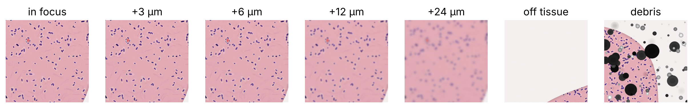
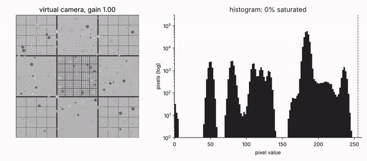

# Slide-scan challenges on the virtual microscope

Three challenges for `hinderling/virtual-microscope`, written in the same format as `docs/gallery.md`. Both use the `histology` backend and talk to it only through pymmcore-plus: `setXYPosition`, `setPosition`, `snap`.

## focus_hold

*H&E-stained tissue section, brightfield (RGB), 10x, depth of field 6 µm*

The slide drifts slowly in z (0.03 ± 0.15 µm per tile) and gets a 10–16 µm bump every 80 tiles. The challenge is to keep a 600-tile snake scan in focus while spending as few extra snaps as possible.

  

**Experiment guide:** Scan a snake path across the tissue. Use only the images to decide when and where to move z, and skip off-tissue tiles (less than 30% tissue). Ground truth is `sim.tissue_z`, which the strategy never reads.

**Score:** fraction of tiles within half a depth of field (±3 µm), and extra snaps as a fraction of tiles.

| Strategy | In focus | Extra snaps |
|---|---|---|
| No correction | 21% | 0% |
| 13-plane AF sweep when normalised sharpness drops below 0.7× the running median | 78% | 93% |
| Estimate \|dz\| from a sharpness calibration curve, probe ±4 µm for the sign, then nudge | 48% | 10% |
| Stand-in for a trained single-shot estimator (true dz + 1 µm noise), nudge by 0.7× | 98% | 0% |

## qc_umap

*Five tissue types (glandular, epithelium, connective, adipose, mixed), 1125 tiles*

Every 20th tissue tile is defocused by 0.5, 1, 2 or 4 DOF beyond the in-focus band, and about 2% of tiles get the backend's own `add_debris` overlay. Off-tissue tiles are gated out by tissue fraction before scoring.

**Experiment guide:** Compute 11 features per tile (4 sharpness measures, RGB mean and spread, tissue fraction), embed them with UMAP for human review, and flag outliers with an isolation forest.

**Score:** recall per category, and the false-alarm rate on clean tissue tiles.

| Category | 0.5 DOF | 1 DOF | 2 DOF | 4 DOF | Debris | False alarms |
|---|---|---|---|---|---|---|
| Flagged | 20% | 100% | 100% | 100% | 100% | 1.0% |

## exposure_teaching

*Hemocytometer counting chamber, brightfield, 8-bit camera*

Turn up the camera gain step by step and watch the histogram walk right until it piles up at 255.

**Experiment guide:** Sweep the `Gain` property of the virtual camera from 1 to 2.6 and back, snap at each step, and plot the image next to its histogram on a log scale.

**Score:** saturated fraction (pixels at 254 or 255). At gain 2.6, 93% of pixels are saturated.

**Why:** oversaturation is the most common beginner mistake. In a twin you can make it a hundred times for free.
