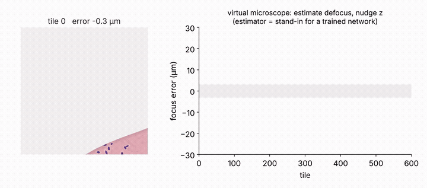
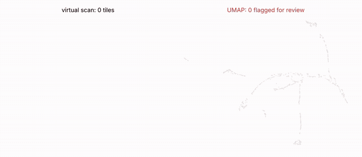
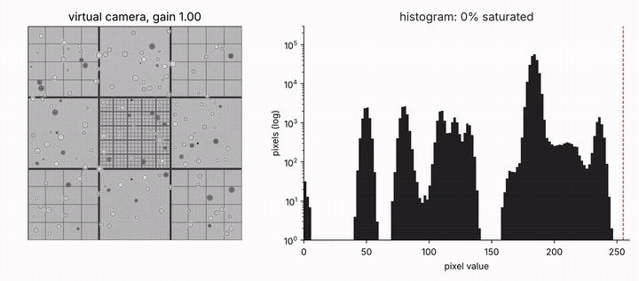
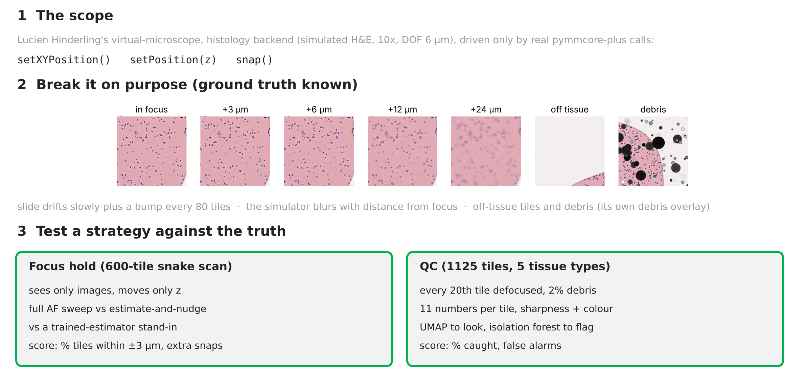
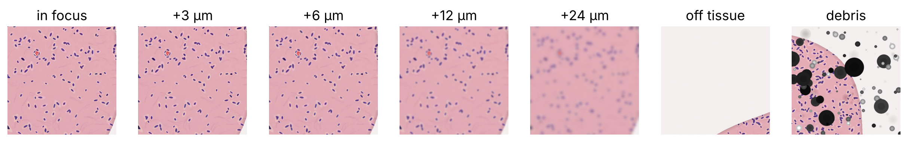
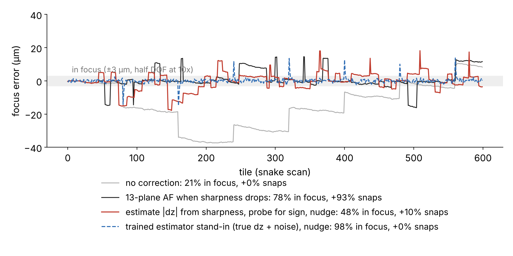
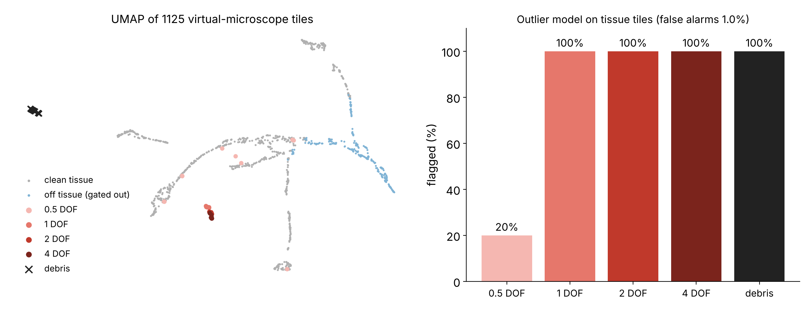
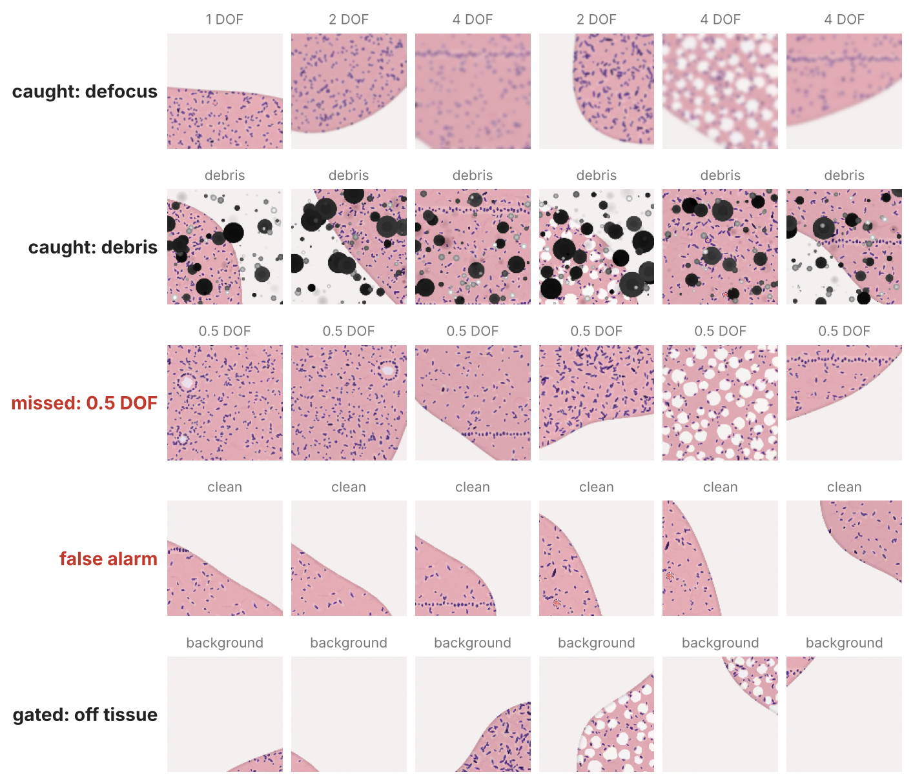

# Slide-scan twin

> **Note:** Work in progress, shared ahead of the Basel smart microscopy hackathon (April 2027). Numbers come from a simulator, not from real slides.

A small set of experiments that use [Lucien Hinderling's virtual microscope](https://github.com/hinderling/virtual-microscope) as a digital twin of a histology slide scanner. The idea is simple. Before we change an autofocus rule or a QC check on a real scanner, we break a simulated one on purpose, thousands of times, with a known right answer, and see which strategy survives.

These experiments were made for the talk *Going headless without losing your mind* at the Lund symposium on AI-ready digital twins of scientific instruments (November 2026), by Mike Abanto, DBM Microscopy Core Facility and Nikon Center of Excellence, University of Basel.

## Gallery

<table>
  <tr>
    <td align="center" width="33%"><br><b>focus_hold</b><br>keep a drifting slide in focus</td>
    <td align="center" width="33%"><br><b>qc_umap</b><br>flag bad tiles during a scan</td>
    <td align="center" width="33%"><br><b>exposure_teaching</b><br>watch the histogram saturate</td>
  </tr>
</table>

**[Challenge descriptions and results →](CHALLENGES.md)**

## New here? What is going on

A digital twin is a simulated instrument that behaves like the real one. Lucien's virtual microscope renders realistic images of 35 different samples and answers to the same commands as a real Micro-Manager microscope through [pymmcore-plus](https://github.com/pymmcore-plus/pymmcore-plus). So code written against the twin is code you could point at a real scope.

Every experiment here follows the same three steps.



**1. The scope.** The `histology` backend simulates an H&E section at 10x with a 6 µm depth of field (DOF). The DOF is the thickness of sample that looks sharp. Move focus by less than half of it and nothing changes, move more and the image blurs.

**2. Break it on purpose.** The experiment sets where the tissue really is, so every tile has a known right answer. The slide drifts slowly, gets bumped, and some tiles are off tissue or carry debris from the simulator's own debris overlay.

**3. Test a strategy against the truth.** Strategies only see images and only move the stage or focus. They are scored against the ground truth they never get to read.



## Installation

```bash
git clone <this repo>
cd slidescan-twin
pip install -e .
```

This pulls in the virtual microscope straight from GitHub, plus numpy, OpenCV, matplotlib, scikit-learn, umap-learn and imageio.

## Quick start

```bash
python experiments/01_exposure_teaching.py --out results   # about 10 s
python experiments/02_focus_hold.py --out results          # about 4 min
python experiments/03_qc_umap.py --out results             # about 4 min
```

Add `--quick` to any of them for a smaller run while you are trying things out. Each script writes a figure, an MP4 and a JSON file with the scores into `results/`.

The heart of every experiment is the same handful of calls you would use on a real microscope:

```python
from slidescan_twin import open_scope

core, sim = open_scope("mixed")      # histology backend, simulated H&E
core.setXYPosition(200, -400)        # move the stage (µm)
core.setPosition(3.0)                # move focus (µm)
img = core.snap()                    # (512, 512, 3) uint8

sim.tissue_z = 12.0                  # ground truth: the experiment moves the tissue, strategies never read this
```

## Results from the talk

**Focus hold.** Four strategies on the same 600-tile scan with slow drift and a 10 to 16 µm bump every 80 tiles. "In focus" means within ±3 µm.

| Strategy | In focus | Extra snaps |
|---|---|---|
| No correction | 21% | 0% |
| 13-plane AF sweep when sharpness drops | 78% | 93% |
| Estimate the defocus from sharpness, probe up or down, nudge | 48% | 10% |
| Stand-in for a trained single-shot estimator, nudge | 98% | 0% |



The loop is not the problem, the estimator is. Sharpness depends on the tissue, it is flat near focus, and a blurred image looks the same above and below focus. The last line is not a real method. It is given the true error plus 1 µm of noise, to show what the loop could do with a good estimator, the role played by [Pinkard et al. 2019](https://doi.org/10.1364/OPTICA.6.000794).

**QC with UMAP.** 1125 tiles from five tissue types. Every 20th tissue tile is defocused and about 2% carry debris.

| | 0.5 DOF | 1 DOF | 2 DOF | 4 DOF | Debris | False alarms on clean tiles |
|---|---|---|---|---|---|---|
| Flagged | 20% | 100% | 100% | 100% | 100% | 1.0% |




Anything a depth of field or more out of focus is caught, and so is debris. Half a depth of field mostly hides in the crowd, and most false alarms are tissue edges. UMAP is good for showing a human what is odd, but mild defocus has to be caught while scanning, not after.

## Specific focus and questions asked

Can a facility develop and test the smart parts of a slide-scanning pipeline (focus holding, quality control, user training) in simulation first, using community tools, before touching a real scanner or a real patient slide?

## Key findings

A twin turns a week of scope time into a minute on a laptop. Even with a simple simulator, it exposed something we did not expect. Image-based focus correction fails without a good defocus estimator, and post-hoc QC misses mild blur. Both point to where the real work is.

## Contributions to interoperability

All experiments talk to the twin through standard pymmcore-plus calls, so the same strategy code can be pointed at a Micro-Manager scope, and through a useq bridge at Nikon NIS-Elements. The plan is to describe these experiments in useq-schema and to share them through the [Smart Microscopy Working Group](https://smartmicroscopy.github.io).

## Limitations

The simulator blurs symmetrically, with no blur inside half a depth of field. It has no angled illumination, so a Pinkard-style estimator cannot be tested yet. The tissue is simulated H&E, not real slides. The focus "trained estimator" is a stand-in. Treat every number here as a sandbox result, not a benchmark.

## Next steps

Add angled-illumination physics to the twin and train a single-shot defocus network there, then test it on a real scope. Repeat the QC test on real scans with pretrained embeddings. Build an open training twin with Image Cooperative. Ideas and help are welcome, at the hackathon in Basel (27 to 30 April 2027) or through the SMWG.

## Credits

This work stands entirely on [Lucien Hinderling's virtual microscope](https://github.com/hinderling/virtual-microscope) and on [pymmcore-plus](https://github.com/pymmcore-plus/pymmcore-plus). The experiment code was written with Claude (Anthropic).

**References.** Hinderling L. et al. *Real-time feedback control microscopy for automation of optogenetic targeting.* bioRxiv (2025), doi:10.1101/2025.08.17.670729. Pinkard H., Phillips Z., Babakhani A., Fletcher D.A., Waller L. *Deep learning for single-shot autofocus microscopy.* Optica 6, 794 (2019). Hinderling L. et al. *Smart microscopy: current implementations and a roadmap for interoperability.* Methods in Microscopy 3(1), 71–91 (2026).
